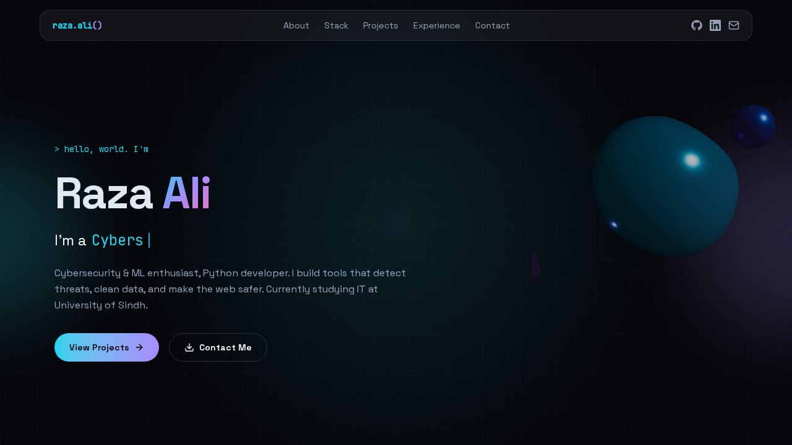

# 🌐 Raza Portfolio

A modern, highly animated 3D portfolio built with Next.js 16, Tailwind CSS 4, Framer Motion, and React Three Fiber.

## 🔗 Live Demo
**[View Live Site →](https://portfolio-smoky-six-22.vercel.app)**

## 📸 Preview


## ✨ Features
- Dark mode glassmorphism UI
- 3D interactive elements (React Three Fiber)
- Smooth scroll animations (Framer Motion)
- Fully responsive
- SEO optimized

## 🛠️ Tech Stack
- **Framework:** Next.js 16 (App Router)
- **Styling:** Tailwind CSS 4
- **Animations:** Framer Motion
- **3D Graphics:** React Three Fiber
- **Deployment:** Vercel

## 🚀 Run Locally
```bash
npm install
npm run dev
```
